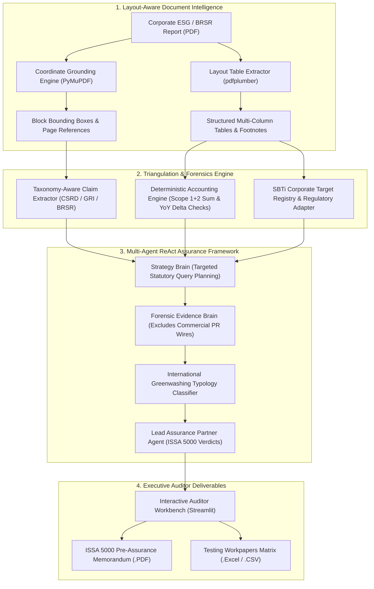

# 🌿 Veritas ESG — Autonomous Forensic Assurance & Greenwashing Intelligence Suite

[](https://www.iaasb.org)
[](https://efrag.org)
[](https://ghgprotocol.org)
[](https://python.org)
[](LICENSE)

An enterprise-grade autonomous forensic assurance platform that audits corporate sustainability disclosures, extracts and reconciles complex financial-grade GHG emission tables, cross-references statutory registries (SBTi, SEC 10-K, SEBI BRSR), detects recognized greenwashing typologies, and generates client-ready **ISSA 5000 Pre-Assurance Memorandums**.

---

## 🏢 The Enterprise Problem Space

Under the **EU CSRD (Corporate Sustainability Reporting Directive)**, **SEC Climate Disclosure Rules**, and **SEBI BRSR Core (India)**, ESG disclosure assurance has transitioned from voluntary public relations into **statutory, legally-binding compliance** requiring independent assurance by firms like Deloitte, PwC, EY, and KPMG.

Corporate sustainability reports present critical verification challenges that generic AI bots fail to solve:
1. **The "Glossy vs. Statutory" Divide:** Companies advertise aspirational net-zero milestones in glossy marketing PDFs while burying caveats, methodology changes, and reliance on unverified offsets in footnotes.
2. **Tabular Data Collapse:** Over 85% of Scope 1, Scope 2, and Scope 3 emissions data resides in nested, multi-column tables. Standard PDF text scrapers flatten tables into unusable word strings.
3. **Mathematical Inconsistencies:** Reports often feature arithmetic discrepancies between direct emissions and reported operational totals, or calculate year-over-year percentage reductions against shifting baseline years without restatement.
4. **Assurance Workpaper Burden:** Auditors require end-to-end evidence trails compliant with **ISSA 5000 (International Standard on Sustainability Assurance 5000)** and **ISAE 3000**, with page/table coordinate traceability and formal assurance opinions.

**Veritas ESG** transforms this manual, month-long audit workflow into an autonomous, forensic AI assurance process.

---

## 🏛️ System Architecture



---

## ⚙️ The Five Architectural Pillars

### 1. Layout-Aware Table Extraction & Footnote Intelligence (`utils/table_parser.py`)
Standard PDF extractors collapse rows and columns. Veritas ESG extracts multi-column emissions tables with exact headers, cell values, and page coordinates, and automatically parses nested footnotes (e.g., *"Scope 2 market-based only"*, *"excludes joint ventures"*).

### 2. Deterministic GHG & Arithmetic Integrity Engine (`utils/math_integrity.py`)
Before querying an LLM, Veritas ESG executes deterministic accounting checks:
* **Summation Audit:** Verifies $\text{Scope 1 (Direct)} + \text{Scope 2 (Indirect)} \stackrel{?}{=} \text{Reported Total Operational GHG}$ within a 2% rounding tolerance.
* **YoY Delta Recalculation:** Recalculates stated percentage reductions against underlying absolute baseline and reporting year metrics.
* **Baseline Drift Detection:** Flags undisclosed adjustments to historical base years.

### 3. Official SBTi Target Registry Validation (`utils/registry_verifier.py`)
Cross-references corporate climate commitments against the **Science Based Targets initiative (SBTi)** registry database:
* Identifies whether targets are *Approved 1.5°C*, *Committed*, *Net-Zero Set*, or *Removed/Revoked*.
* Flags unsubstantiated net-zero claims where no formal regulatory submission exists.

### 4. International Greenwashing Typology Classifier (`utils/registry_verifier.py`)
Classifies audit exceptions against regulatory standards established by the **EU Green Claims Directive**, **UK CMA**, and **Planet Tracker**:
* **Selective Disclosure:** Highlighting Scope 1 & 2 while concealing Scope 3 (which represents 80%+ of real emissions).
* **Greenrinsing:** Shifting baseline years or weakening targets before maturity without explanation.
* **Unsubstantiated Offsetting:** Claiming "Carbon Neutrality" using low-quality avoidance credits rather than operational decarbonization.
* **Greenlighting:** Amplifying an isolated eco-pilot while primary operations remain carbon-intensive.

### 5. Client-Ready ISSA 5000 Deliverables (`utils/report_generator.py`)
Generates formal, publication-quality assurance workpapers:
* **ISSA 5000 Pre-Assurance Memorandum (PDF):** Executive summary, risk scorecard, itemized testing table, and Engagement Partner digital sign-off.
* **Complete Audit Matrix (Excel / CSV):** Full workpaper spreadsheet with page numbers, statutory mappings, evidence URLs, and auditor notes.

---

## 🖥️ Executive Auditor Workbench

The modern dashboard features:
* **Executive Risk Scorecard:** Real-time **Veritas Greenwashing Exposure Score ($0-100$)** and **Assurance Readiness Index ($0-100\%$)**.
* **Pre-Loaded Instant Audit Cases:** Test instantly with zero configuration:
  * 🏢 **Tata Motors Limited:** Automotive ESG disclosure & BRSR Principle 6 metrics.
  * 🏢 **Infosys Limited:** IT services SBTi-approved 1.5°C net-zero trajectory.
  * 🚨 **Apex Global Industries:** Synthetic forensic case featuring intentional arithmetic inconsistencies and selective offset disclosures.
* **Human-in-the-Loop (HITL) Adjudication:** Engagement reviewers can add forensic notes, flag exceptions, and mark items as *Approved*, *Requires Inquiry*, or *Immaterial*.

---

## 🚀 Quickstart & Setup

### Prerequisites
* Python 3.10 to 3.14
* Git

### Installation
```bash
# 1. Clone the repository
git clone https://github.com/navyarangwani/veritas-esg.git
cd veritas-esg

# 2. Install enterprise dependencies
pip install -r requirements.txt
```

### Environment Configuration (Optional)
Create a `.env` file in the root directory:
```env
# Optional: Cloud LLM & Search API Keys
GROQ_API_KEY=your_groq_api_key_here
TAVILY_API_KEY=your_tavily_api_key_here

# Optional: OpenAI / Gemini support
OPENAI_API_KEY=your_openai_key_here
```

> **Zero-Config Resilient Mode:** If no API keys are provided, Veritas ESG automatically falls back to its built-in heuristic forensic auditor and DuckDuckGo search adapter, allowing recruiters and evaluators to test the entire suite out-of-the-box!

### Launching the Enterprise Assurance Platform

Veritas ESG provides two institutional interfaces:

#### Option 1: Full-Stack Enterprise Auditor Web Application (React 19 + FastAPI)
*The flagship Big 4 assurance terminal featuring dual-pane document grounding, interactive claim matrix, and zero-gradient formal design.*

```bash
# Terminal 1: Launch FastAPI Backend
python -m uvicorn server:app --host 127.0.0.1 --port 8000

# Terminal 2: Launch React Frontend (Vite live-reload)
cd frontend
npm run dev
# Access the web terminal at: http://localhost:5173 (or http://localhost:8000 for bundled production)
```

#### Option 2: Python Institutional Auditor Workbench (Streamlit)
*A standalone, formal single-command auditor workbench for quick local testing and demos.*

```bash
python -m streamlit run app.py
```

---

## 📂 Project Structure

```
veritas-esg/
├── app.py                      # Executive Auditor Workbench (Streamlit UI)
├── requirements.txt            # Enterprise dependencies
├── sample_reports/             # Pre-loaded corporate ESG & forensic audit cases
│   ├── generate_samples.py     # Deterministic sample PDF generator
│   ├── tata_motors_esg_sample.pdf
│   ├── infosys_esg_sample.pdf
│   └── synthetic_greenwashing_audit_case.pdf
└── utils/
    ├── pdf_parser.py           # Brain 1 — Layout coordinate grounding (PyMuPDF)
    ├── table_parser.py         # Brain 1 — Tabular matrix & footnote extractor (pdfplumber)
    ├── cleaner.py              # Brain 1 — Document normalizer & noise scrubber
    ├── chunker.py              # Brain 2 — High-performance recursive text chunker
    ├── claim_extractor.py      # Brain 2 — Multi-source claim & tabular extractor
    ├── claim_normalizer.py     # Brain 2 — Semantic deduplication engine
    ├── math_integrity.py       # Brain 2.5 — Deterministic Scope 1-3 & YoY math auditor
    ├── registry_verifier.py    # Brain 2.5 — SBTi target registry & typology classifier
    ├── strategy_brain.py       # Brain 3 — Statutory search query strategist
    ├── evidence_brain.py       # Brain 4 — Forensic evidence retriever (PR wire filtered)
    ├── judgment_brain.py       # Brain 5 — Senior Assurance Partner evaluation engine
    ├── confidence_engine.py    # Brain 6 — Corporate risk & readiness scoring engine
    ├── report_generator.py     # Brain 6 — ISSA 5000 PDF & Excel deliverable builder
    ├── agent_orchestrator.py   # Multi-agent assurance pipeline coordinator
    ├── llm_provider.py         # Resilient multi-provider LLM gateway with auto-fallback
    └── prompts.py              # ISSA 5000 / CSRD forensic audit prompts
```

---

## 📜 Regulatory Standards Mapping

| Standard / Framework | Regulatory Authority | Veritas ESG Implementation |
| :--- | :--- | :--- |
| **ISSA 5000** | IAASB (Global) | Evaluates limited assurance readiness, material misstatements, and generates pre-assurance workpaper memorandums. |
| **CSRD / ESRS E1** | EFRAG / European Union | Mandatory Scope 1, 2, and 3 disclosure taxonomy mapping; flags missing supply-chain categories. |
| **GHG Protocol** | WRI / WBCSD | Location-based vs. market-based Scope 2 validation, Scope 1 direct emissions verification. |
| **SEBI BRSR Core** | SEBI (India) | Key performance indicator assurance across Principle 6 (Emissions, Water, Waste, Energy). |
| **Green Claims Directive**| European Commission | Typology classification for greenwashing, unsubstantiated offsets, and selective disclosure risks. |

---

## 👩‍💻 Author & Engineering Credits
* **Built by:** Navya Rangwani
* **Affiliation:** VES Institute of Technology
* **Focus:** AI in Enterprise Sustainability Assurance, Agentic Workflows, and Forensic Compliance Systems.
